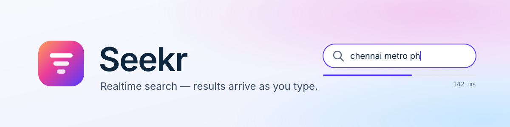
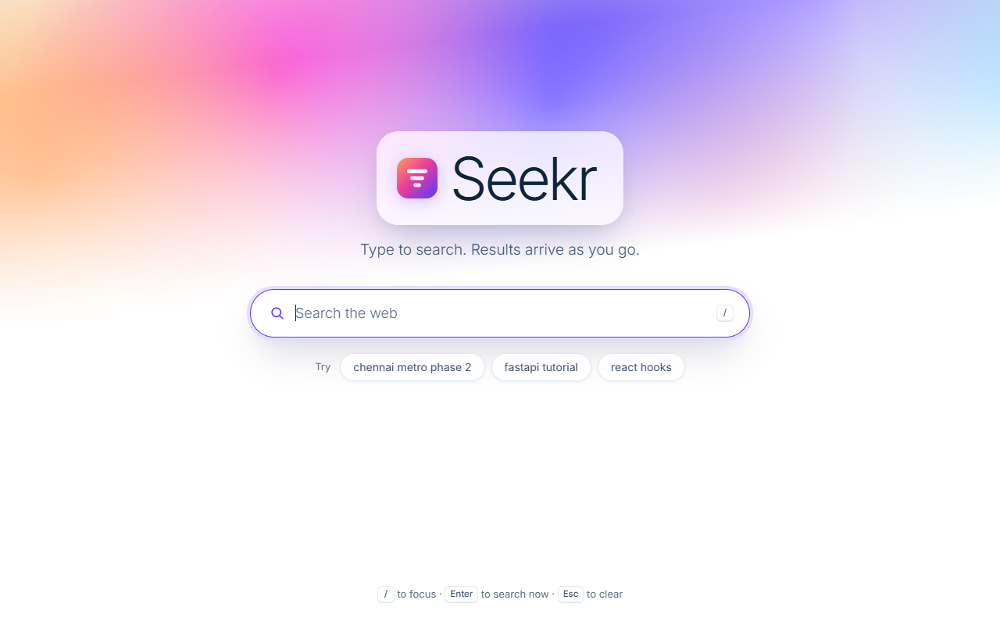
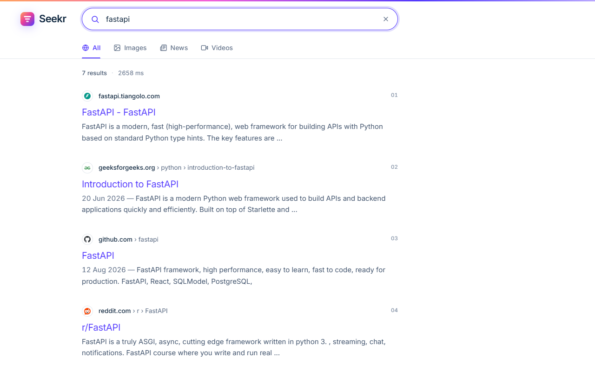
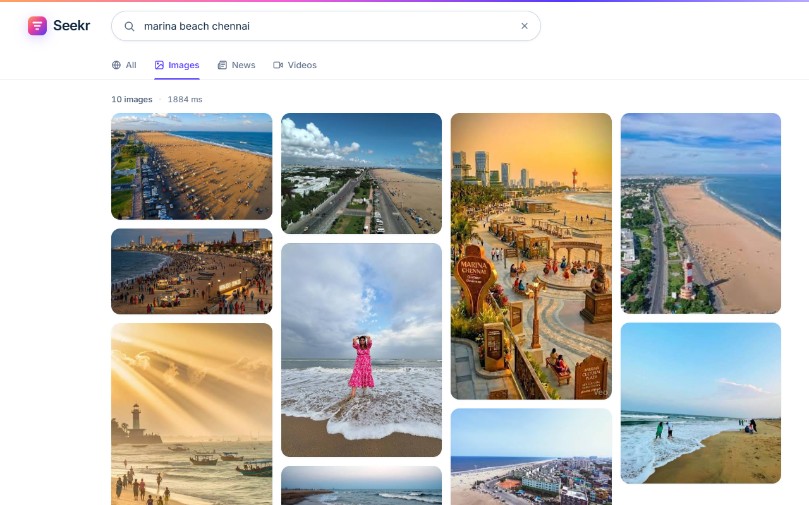
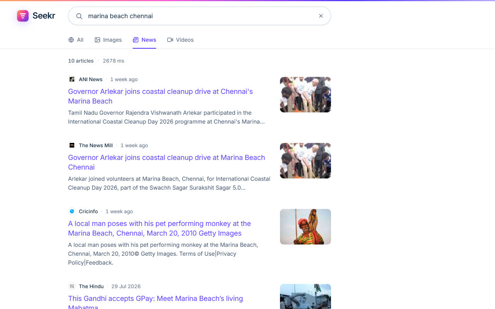
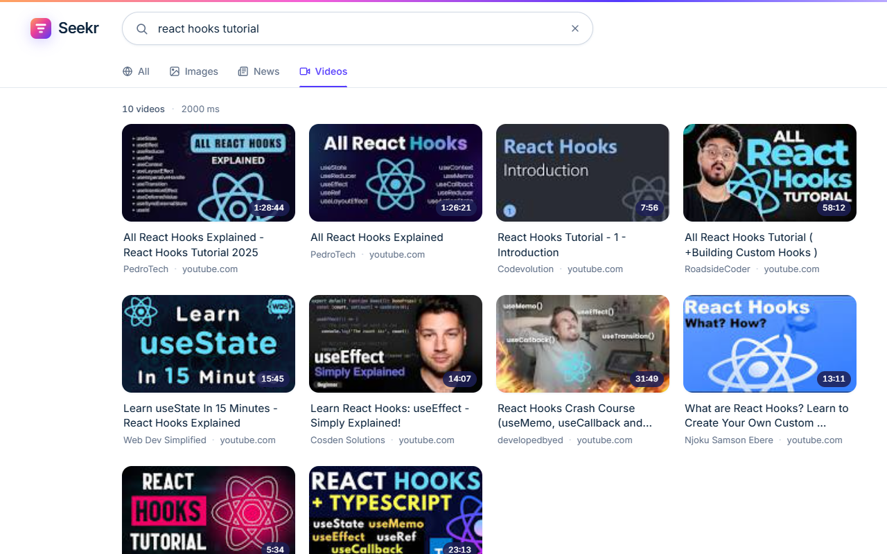
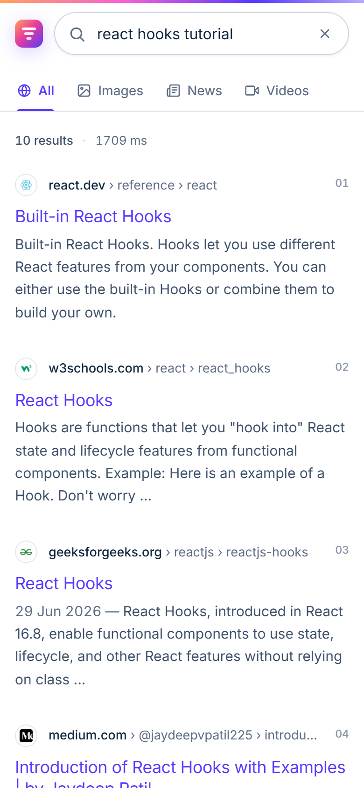

<div align="center">



<br/>


**A fast search engine you run yourself. Results update while you're still typing.**

</div>

---

## Overview

Seekr is a full-stack search application with four search modes (**All, Images, News, Videos**), an instant-answer card, a knowledge panel, "People also ask", and related searches.

The React frontend never talks to a search provider directly. It calls Seekr's own FastAPI backend, which holds the API key, caches responses, and turns every provider's data into one consistent format.

Seekr has two search engines behind one API:

| Source | When it's used |
|---|---|
| **Live Google results** via the [Serper](https://serper.dev) API | Whenever `SERPER_API_KEY` is set (the default setup) |
| **Built-in local index** (BM25 ranking over `backend/data/corpus.json`) | With no key, or automatically as a fallback when there's no internet or Serper is out of credits |

The fallback means Seekr keeps working with no internet connection.

## Screenshots

| Home | Web results |
|---|---|
|  |  |

| Images | News |
|---|---|
|  |  |

| Videos | Mobile |
|---|---|
|  |  |

## Features

- **Search as you type.** A search fires 350 ms after the last keystroke. Starting a new one cancels the old request, so a slow reply can never overwrite a newer one.
- **Four tabs.** Web, Images (masonry grid), News and Videos. Switching tabs re-runs the current query immediately.
- **Rich results.** Answer card, knowledge panel with key facts, "People also ask" and related searches.
- **Keeps working offline.** If Serper can't respond, Seekr answers from the local index without showing an error.
- **Visible speed.** A progress line under the search bar shows each search running and prints how long it took. A "Cached" chip marks results served from the 5-minute cache.
- **Shareable URLs.** The query and tab are kept in the address bar (`?q=...&type=...`), so reloading or sharing a link gives the same results.
- **Keyboard first.** `/` focuses the search box, `Enter` searches now, `Esc` clears.
- **Responsive and accessible.** Works down to 360 px wide, with visible keyboard focus and screen-reader labels.

## Tech stack

| Layer | Technology |
|---|---|
| Frontend | React 18, Vite 5, plain JavaScript (JSX), hand-written CSS design system |
| Backend | Python, FastAPI, Uvicorn |
| Search | Serper (Google Search API) plus a built-in BM25 index |
| Deployment | One process serves both the API and the built frontend · Docker |

## Getting started

### Prerequisites

- [Python](https://www.python.org/downloads/) 3.10 or newer
- [Node.js](https://nodejs.org/) 18 or newer

### Quick start (Windows)

```bat
setup.bat
start.bat
```

`setup.bat` runs once. It creates a Python virtual environment and installs all packages. `start.bat` opens the API on port 8000 and the web app on port 5173.

Then open **http://localhost:5173**.

### Quick start (macOS / Linux)

```bash
./setup.sh
./start.sh
```

### Manual setup

```bash
# 1. Backend
cd backend
python -m venv .venv
.venv\Scripts\activate              # macOS/Linux: source .venv/bin/activate
pip install -r requirements.txt
uvicorn main:app --reload --port 8000

# 2. Frontend (in a second terminal)
cd frontend
npm install
npm run dev
```

## Configuration

Settings are read from `backend/.env`. A ready-to-use `.env` with a Serper key is included; `backend/.env.example` documents every option.

| Variable | Default | Description |
|---|---|---|
| `SERPER_API_KEY` | *(included)* | API key from [serper.dev](https://serper.dev). If empty, only the local index is used. |
| `SEARCH_PROVIDER` | `auto` | `auto`: live results, local fallback · `serper`: live only · `local`: offline index only |
| `PORT` | `8000` | Port used by `python main.py` |
| `CORS_ORIGINS` | `http://localhost:5173` | Origins allowed to call the API during development |

> **Keep the key private.** `backend/.env` is listed in `.gitignore`, so it stays out of Git. Don't commit it or post it publicly. If it ever leaks, create a new key in the Serper dashboard. The free plan includes 2,500 searches.

## How it works

```
Browser ──▶ GET /api/search?q=...&type=web
              │
              ▼
        FastAPI (backend/main.py)
              ├─ validate input, 5-minute cache → "Cached" chip
              ├─ SerperSearch   (serper_search.py)  live Google results
              └─ LocalSearch    (local_search.py)   BM25 index, used offline / as fallback
              │
              ▼
        one consistent JSON response → React renders the matching tab
```

Every response looks the same whichever source answered it. Optional parts (answer box, knowledge panel) are `null` when missing, never placeholders, so the frontend doesn't need to know which engine replied.

### Extending the local index

The offline index is plain JSON in `backend/data/corpus.json`. Add entries and restart the API:

| Section | Powers |
|---|---|
| `web` | the All and Images tabs (`title`, `link`, `snippet`, optional `tags`, `sitelinks`) |
| `knowledge` | the knowledge panel, shown when a `match` phrase is in the query |
| `answers` | the answer card, shown when all of its `match` phrases are in the query |
| `questions` | "People also ask" |
| `news`, `videos` | the News and Videos tabs |

## API reference

| Method | Endpoint | Description |
|---|---|---|
| `GET` | `/api/search?q=&type=&page=` | `type`: `web`, `images`, `news`, `videos` (default `web`). `page`: 1–10. |
| `GET` | `/api/health` | Health check: `{"status": "up", "provider": "auto"}` |
| `GET` | `/api/thumb?t=&kind=` | Generated SVG thumbnail used by the local index |

Every search response includes `query`, `type`, `page`, `tookMs`, `cached`, `source` (`serper` or `local`) and the result lists. Errors return `{ "message", "hint", "status" }`.

Interactive API docs: **http://localhost:8000/docs**

## Deployment

### Single process

In production the backend serves the built frontend, so the whole app runs on one port:

```bash
cd frontend && npm run build
cd ../backend && uvicorn main:app --host 0.0.0.0 --port 8000
```

### Docker

```bash
docker build -t seekr .
docker run -p 8000:8000 -e SERPER_API_KEY=your-key seekr
```

The image works on any container host: [Render](https://render.com), [Railway](https://railway.app), [Fly.io](https://fly.io) or your own server. Set `SERPER_API_KEY` as an environment variable in the host's dashboard instead of copying the `.env` file. The app uses the `PORT` variable the host provides.

## Project structure

```
seekr/
├── backend/
│   ├── main.py              API routes, caching, errors, serves the built frontend
│   ├── serper_search.py     live Google results via Serper
│   ├── local_search.py      BM25 search index + SVG thumbnails
│   ├── data/corpus.json     content for the local index
│   ├── requirements.txt
│   ├── .env                 your settings (not committed)
│   └── .env.example         documented template
├── frontend/
│   ├── src/
│   │   ├── App.jsx          app state: debounce, cancellation, URL sync
│   │   ├── api.js           API client
│   │   ├── components/      SearchBar, Tabs, ResultList, ImageGrid, NewsList, ...
│   │   └── index.css        design system
│   ├── index.html
│   └── vite.config.js
├── docs/                    banner + screenshots
├── Dockerfile
├── setup.bat · start.bat    Windows helpers
└── setup.sh  · start.sh     macOS / Linux helpers
```
